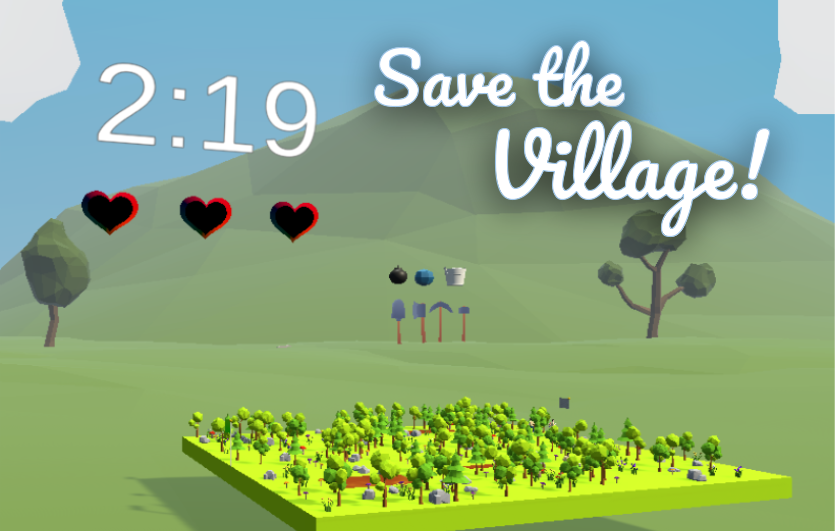
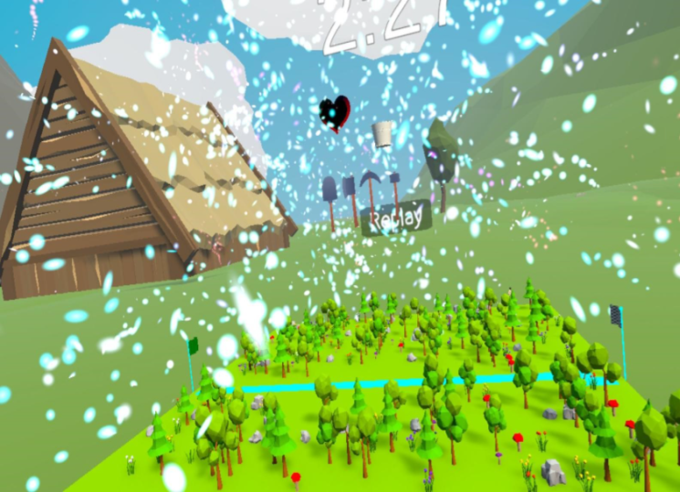
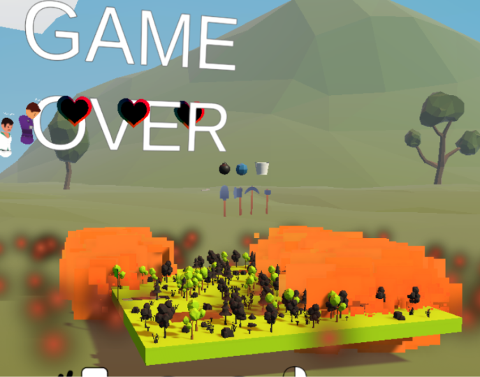
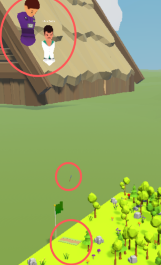

## Save the Village: A collaborative VR game for the Meta Quest headset 

Save the Village is a multi-player collaborative VR game built in Unity(6.3.5f2) and C# using the [Ubiq](https://ubiq.online/) library. It uses the Universal Rendering Pipeline and Input System Package.

Players must race the clock and work together to create a pathway through the forest and get the villagers to safety before a fire destorys their home. Connect the START block to the FINISH block before time runs out! Keep villagers away from lava - lift them to high ground if they get too close - and watch your path... it'll wear down over time. 

Scripts for player interactions, villager behaviour and other gameplay mechanics can be found in [Assets/Scripts](https://github.com/nellie-sze/Save-the-Village-Game/tree/main/Assets/Scripts).

#### Tools: 
- Shovel: Build paths
- Axe: Cut down trees and plants
- Pickaxe: Smash rocks
- Hammer: Destroy paths

#### Powerups: 
- Ice cube: Temporarily freeze all villagers
- Bomb: Blow up obstacles
- Water bucket: Clear away lava

### Gallery

### Required Assets/Packages
Note: The listed assets are not included in the repository and must be downloaded.
- Simple Gems and Items by [BTM_Assets](https://assetstore.unity.com/packages/3d/props/simple-gems-and-items-ultimate-animated-customizable-pack-73764)
- 3D Road Tiles by [Kenney](https://kenney.nl/assets/3d-road-tiles)
- Inferno World Free by [ithappy](https://assetstore.unity.com/packages/3d/environments/fantasy/inferno-world-free-low-poly-3d-models-328402)
- Low Poly Casual Bucket by [Revereel Studio](https://assetstore.unity.com/packages/3d/props/tools/low-poly-casual-bucket-287902)
- Stylised Explosives by [RG Poly](https://assetstore.unity.com/packages/3d/props/stylized-explosives-aaa-urp-287118)
- City People by [Denys Almaral](https://assetstore.unity.com/packages/3d/characters/city-people-free-samples-260446)
- Basic Tools by [Veresen](https://assetstore.unity.com/packages/3d/props/tools/basic-tools-low-poly-stylized-294356)
- RPG Poly Pack by [Gigel3d](https://assetstore.unity.com/packages/3d/environments/landscapes/rpg-poly-pack-lite-148410)
- Flags and Rainbow Shaders by [Panettone Games](https://assetstore.unity.com/packages/vfx/shaders/flag-and-rainbow-shaders-224583)
- Fireworks by [OccaSoftware](https://assetstore.unity.com/packages/vfx/particles/fire-explosions/fireworks-realistic-fireworks-with-vfx-graph-208311)
- Ubiq, WebRTC
- XR Core Utilities, XR Hands, XR Interaction Toolkit

